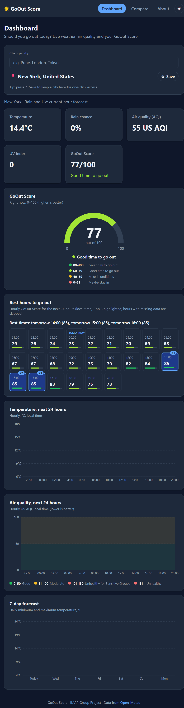

# GoOut Score React Dashboard

A React dashboard that answers one question: **is it a good time to go outside?** It combines live
weather and air-quality data from the free [Open-Meteo](https://open-meteo.com) APIs into a single
0–100 **GoOut Score** for any city in the world. No API key, no backend, no sign-up.

**Live site:** https://imap-react-dashboard.vercel.app

> IMAP group project: "React Dashboard Consuming an API".

## Screenshots

| Dashboard | Compare | Dark mode | Phone |
|---|---|---|---|
| _screenshot: `docs/dashboard.png`_ | _screenshot: `docs/compare.png`_ | _screenshot: `docs/dark.png`_ | _screenshot: `docs/mobile.png`_ |

<!-- Add images to a docs/ folder and replace the placeholders, e.g.  -->

## Features

- **Live conditions:** temperature, rain chance, air quality (US AQI) and UV index, with loading, error and retry states
- **GoOut Score:** 0–100 score with a colour-coded gauge and label
- **Best hours to go out:** hourly score timeline for the next 24 hours, top 3 highlighted
- **Charts (Recharts):** next-24 h temperature, 7-day min/max forecast, next-24 h AQI with category bands
- **City search:** autocomplete with the Open-Meteo geocoding API, debounced (300 ms), keyboard friendly, "no results" and error messages
- **Compare page:** two cities side by side with a clear verdict, e.g. "Pune is better for going out right now (score 72 vs 41)"
- **Favourite cities:** star a city, then pick it again from quick-select chips (saved in localStorage)
- **Dark mode:** toggle in the navbar; follows your system setting until you choose, and remembers your choice
- **Remembers your city:** the last selected city is restored after a reload
- **Responsive:** works from phone width up to desktop, with no horizontal scrolling

## Tech stack

- [React 18](https://react.dev) + [Vite](https://vitejs.dev)
- [React Router v6](https://reactrouter.com) (Dashboard, Compare, About, 404)
- [Recharts](https://recharts.org) for charts
- CSS Modules + global CSS variables (light and dark themes)
- React Context for shared city / favourites state
- GitHub Actions (build check) and Vercel (hosting)

## How the GoOut Score works

Every city starts at 100 points, and points are taken away for each condition that makes going out less pleasant:

```
score = 100
score -= |temperature − 25| × 2            (2 points per °C away from 25 °C)
score -= rain_probability × 0.4            (0.4 points per % chance of rain)
score -= max(0, us_aqi − 50) × 0.3         (0.3 points per AQI point above 50)
score -= max(0, uv_index − 6) × 4          (4 points per UV point above 6)
score  = clamp(round(score), 0, 100)
```

| Score | Label |
|---|---|
| 80–100 | Great day to go out |
| 60–79 | Good time to go out |
| 40–59 | Mixed conditions |
| 0–39 | Maybe stay in |

If any input is missing, no score is shown (it is never treated as 0). This is a comfort heuristic made for
this project, not an official health or safety index.

## Run locally

Requires Node.js 18+ (CI uses Node 20).

```bash
npm install
npm run dev
```

Then open http://localhost:5173. Build for production with `npm run build` and preview it with `npm run preview`.

## Project structure

```
.github/workflows/ci.yml   # GitHub Actions: npm ci + npm run build on PRs and pushes to main
vercel.json                # SPA rewrite so /compare and /about work on reload
index.html                 # sets the saved/system theme before React loads (no flash)
src/
  main.jsx                 # BrowserRouter + CityProvider + App
  App.jsx                  # routes: / , /compare , /about , *
  index.css                # design tokens, light + dark theme variables
  api/weather.js           # DEFAULT_CITY, fetchWeather, fetchAirQuality, getCurrentConditions, searchCities
  context/CityContext.jsx  # selected city + favourites, saved to localStorage
  hooks/
    useFetch.js            # { data, loading, error, retry } with timeout + abort
    useCityWeather.js      # weather + air quality + GoOut Score for one city
    useDebounce.js         # delays the search query by 300 ms
    useTheme.js            # light / dark theme, saved choice or system preference
  utils/
    goOutScore.js          # calculateGoOutScore + SCORE_LEVELS
    chartData.js           # reshapes API data into chart rows
    chartTheme.js          # shared Recharts styling (uses CSS variables)
    storage.js             # safe localStorage read / write (try/catch)
  components/              # Layout, Navbar, Footer, CitySearch, FavouriteButton, FavouriteChips,
                           # CompareColumn, ChartCard, ScoreGauge, BestHours, HourlyTempChart,
                           # DailyForecastChart, AqiTrendChart (+ CSS Modules)
  pages/                   # Dashboard, Compare, About, NotFound
```

## Team

| Part | Member | Responsibility |
|---|---|---|
| 1 | Adwait | Project setup, routing, layout, design tokens |
| 2 | Ryan | API layer, useFetch hook, GoOut Score logic, live cards |
| 3 | Arham | Charts and visualisation (Recharts, gauge, best hours) |
| 4 | Yugraj | City search, Compare page, favourites, dark mode, CI, README, deployment |

## API credits

All data comes from [Open-Meteo](https://open-meteo.com) (free, no API key, CC BY 4.0):

- [Forecast API](https://open-meteo.com/en/docs): temperature, rain probability, UV index, 7-day forecast
- [Air Quality API](https://open-meteo.com/en/docs/air-quality-api): current and hourly US AQI
- [Geocoding API](https://open-meteo.com/en/docs/geocoding-api): city search

Weather data by [Open-Meteo.com](https://open-meteo.com/).
